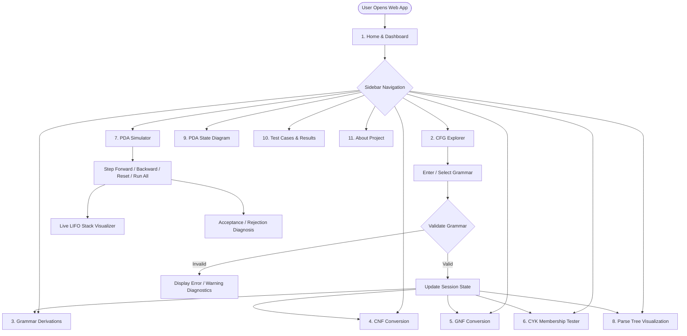
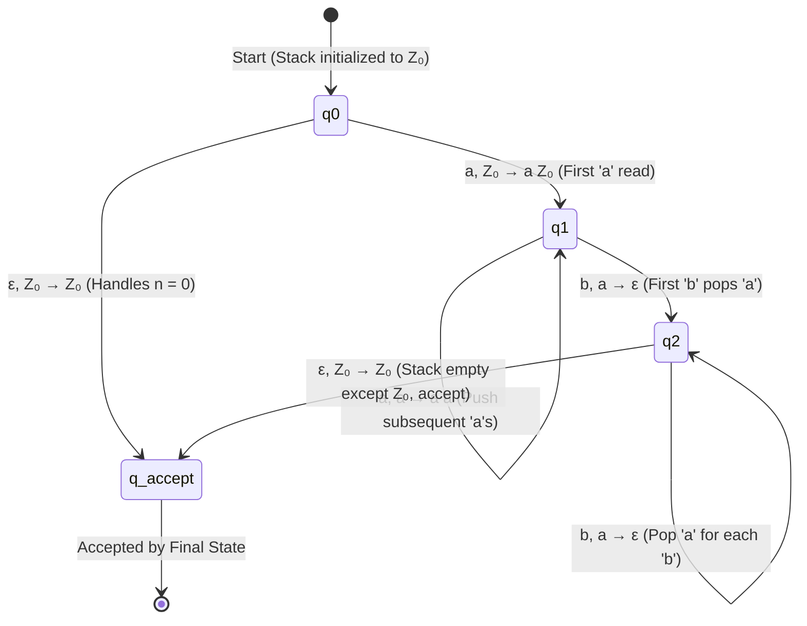

# System Flowcharts & Automata Diagrams

This document contains Mermaid diagrams illustrating the architecture, CYK dynamic programming algorithm, Pushdown Automaton state transitions, and the 6-stage Chomsky Normal Form (CNF) conversion pipeline.

---

## 1. Overall System Architecture & Navigation Flowchart



---

## 2. CYK Dynamic Programming Parsing Flowchart

```mermaid
flowchart TD
    A([Input: Grammar G and String w = w₁w₂...wₙ]) --> B{Is G in CNF?}
    B -- No --> C[Display Warning / Auto-Convert to CNF]
    C --> D
    B -- Yes --> D{Is String Empty: n = 0?}

    D -- Yes --> E{Does G contain S → ε?}
    E -- Yes --> F([ACCEPT w = ε])
    E -- No --> G([REJECT w = ε])

    D -- No --> H[Initialize Triangular Table T of size n × n]
    H --> I[Length l = 1 Base Case: For each i in 1..n, add A if A → wᵢ ∈ P]
    I --> J[Initialize Substring Length l = 2]

    J --> K{l ≤ n?}
    K -- Yes --> L[For each start position i in 0 .. n - l]
    L --> M[For each partition split point k from 1 to l - 1]
    M --> N[Look up Left Cell T[k, i] and Right Cell T[l-k, i+k]]
    N --> O{Any rule A → B C with B ∈ Left and C ∈ Right?}
    O -- Yes --> P[Add A to Cell T[l, i] with backpointer record]
    O -- No --> Q[Continue split point]
    P --> Q
    Q --> R{More split points k?}
    R -- Yes --> M
    R -- No --> S{More start positions i?}
    S -- Yes --> L
    S -- No --> T[Increment l = l + 1]
    T --> K

    K -- No --> U[Inspect Root Cell T[n, 0] covering w₁...wₙ]
    U --> V{Is Start Symbol S ∈ T[n, 0]?}
    V -- Yes --> W([ACCEPT: w ∈ L(G)])
    V -- No --> X([REJECT: w ∉ L(G)])
```

---

## 3. Predefined Pushdown Automaton ($a^n b^n$) State Diagram



---

## 4. Chomsky Normal Form (CNF) 6-Stage Conversion Flowchart

```mermaid
flowchart TD
    S0[Original CFG] --> S1[Stage 1: Start Symbol Isolation S₀ → S]
    S1 --> S2[Stage 2: Epsilon Production Elimination]
    S2 --> S2a[Find Nullable Variables: N = {A | A ⇒* ε}]
    S2a --> S2b[Substitute Nullable Combinations; Add S₀ → ε if ε ∈ L(G)]
    S2b --> S3[Stage 3: Unit Production Elimination A → B]
    S3 --> S3a[Compute Unit Pairs A ⇒* B via Transitive Closure]
    S3a --> S3b[Replace Unit Productions with Target Rules]
    S3b --> S4[Stage 4: Removal of Useless & Unreachable Symbols]
    S4 --> S4a[Keep Productive/Generating Symbols]
    S4a --> S4b[Keep Symbols Reachable from Start Symbol S₀]
    S4b --> S5[Stage 5: Replace Terminals in Long Productions len ≥ 2]
    S5 --> S5a[Introduce T_a → a and substitute T_a in long bodies]
    S5a --> S6[Stage 6: Binarization of Long Bodies len > 2]
    S6 --> S6a[Cascade intermediate variables C₁, C₂, ...]
    S6a --> FinalCNF([Final CNF Grammar: Validated A → BC or A → a])
```
